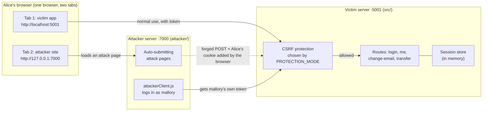
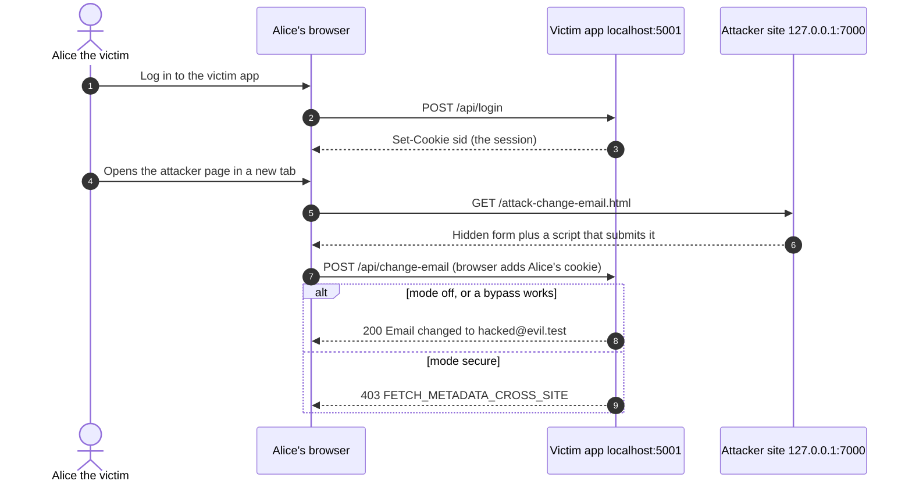
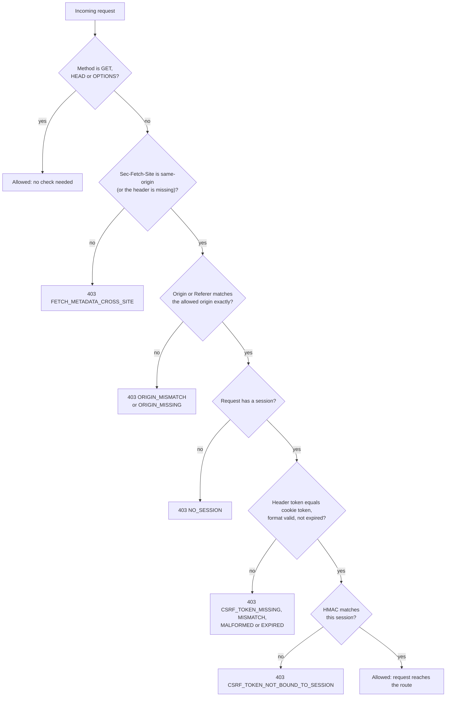
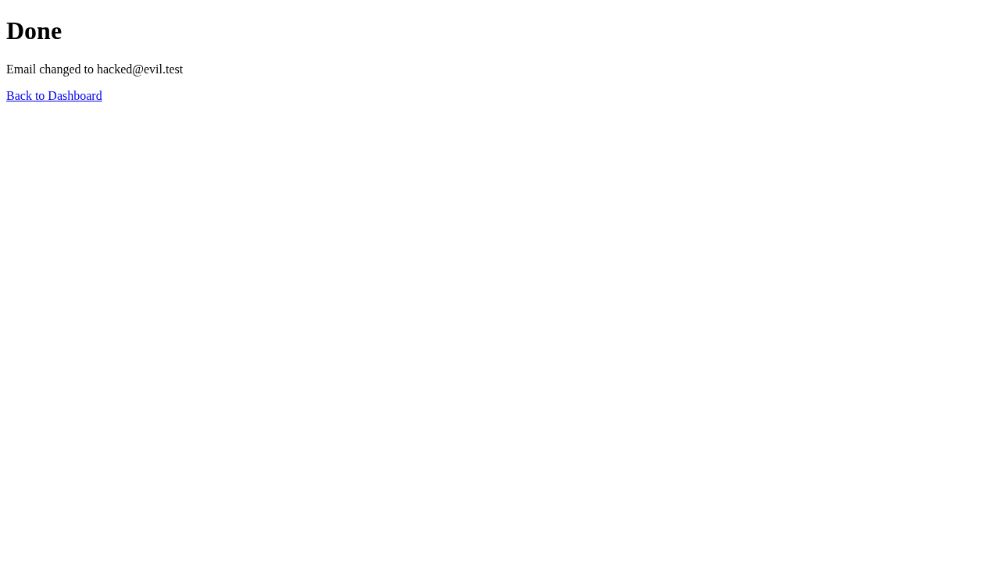
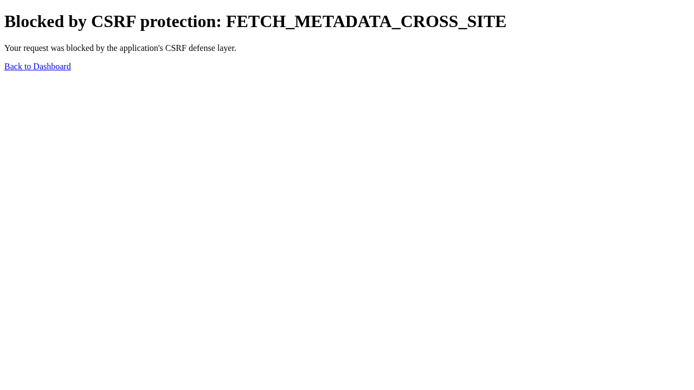
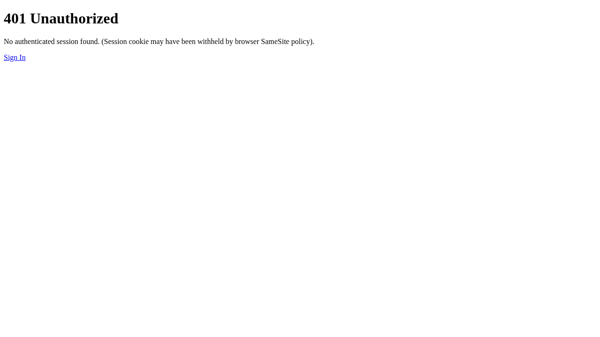

# CSRF Protection and Attack Lab

> **Warning:** this is an intentionally vulnerable lab. Three of the four modes (`off`, `weak-token`, `weak-referer`) are insecure on purpose. The servers listen on `127.0.0.1` only. Never deploy this app.

You attack a vulnerable website with CSRF yourself, then switch on the defense and watch the same attack get blocked. The project has a bank-style victim app, a separate attacker website, 4 protection modes, a reusable CSRF middleware, and automated tests.

## Contents

1. [Architecture](#architecture)
2. [The 4 modes](#the-4-modes)
3. [Quick start](#quick-start)
4. [Run the attacks step by step](#run-the-attacks-step-by-step)
5. [How the protection works](#how-the-protection-works)
6. [Why SameSite is set to None in the lab](#why-samesite-is-set-to-none-in-the-lab)
7. [Automated tests](#automated-tests)
8. [Results and screenshots](#results-and-screenshots)
9. [Project structure](#project-structure)
10. [Troubleshooting](#troubleshooting)
11. [Known limitations](#known-limitations)
12. [More documentation](#more-documentation)

---

## Architecture

### Who talks to whom

Alice uses one browser with two tabs. The browser sends Alice's session cookie to the victim app on every request, even when the request was started by the attacker's page. That is the whole idea behind CSRF.



`localhost` and `127.0.0.1` are different sites for the browser. That makes the attacker page truly cross-site, so the demo is realistic.

### What one attack looks like



### The checks in `secure` mode

Every request passes through this pipeline, in this order. The first failed check stops the request.



---

## The 4 modes

Pick the mode when you start the lab. Only the mode changes; the app and the attack pages stay the same.

| Mode | What the server does | The weakness |
|---|---|---|
| `off` | No CSRF check at all | Every attack works |
| `weak-referer` | Blocks a request only if a `Referer` header is present and wrong | **Bypass 2:** hide the `Referer` header and the check is skipped |
| `weak-token` | Accepts any token the server ever issued, to anyone | **Bypass 1:** the attacker uses a token from their own account against the victim |
| `secure` | The full defense: method allowlist, Fetch Metadata, Origin check, and a session-bound signed token | None of the 4 attacks work |

The 4 attack pages on the attacker site:

| Page | What it tries |
|---|---|
| `attack-change-email.html` | Changes Alice's email to `hacked@evil.test` with a plain forged form |
| `attack-transfer.html` | Sends 500 from Alice to `mallory` with a plain forged form |
| `attack-unbound-token.html` | **Bypass 1.** Logs in as `mallory` on the server side, takes mallory's own token, and puts it in the forged form |
| `attack-no-referrer.html` | **Bypass 2.** Same as change-email, but tells the browser to send no `Referer` header |

---

## Quick start

**You need:** Node.js 18 or newer, and Chrome, Edge or Firefox.

```bash
npm install
npm run setup        # creates .env with a random secret
```

Start the lab in the mode you want. Keep this terminal open.

```bash
npm run lab:off
npm run lab:weak-referer
npm run lab:weak-token
npm run lab:secure
```

| What | URL |
|---|---|
| Victim app | `http://localhost:5001` |
| Attacker site | `http://127.0.0.1:7000` (type `127.0.0.1`, not `localhost`) |

Demo accounts:

| User | Password | Role | Start |
|---|---|---|---|
| `alice` | `alice-password` | The victim | email `alice@example.com`, balance 1000 |
| `mallory` | `mallory-password` | The attacker's own account | balance 0 |

To switch modes: press `Ctrl+C`, then start another mode. All data is in memory, so a restart also resets the accounts and sessions. Log in as Alice again after every restart.

---

## Run the attacks step by step

Use **one browser window** for the whole demo. Alice's cookie must be in the same browser that opens the attacker page.

### Mode 1: `off` (no protection)

1. Run `npm run lab:off`.
2. Open `http://localhost:5001/login.html`. Log in as `alice` / `alice-password`. The dashboard shows `alice@example.com` and balance `1000`.
3. In a **new tab of the same browser**, open `http://127.0.0.1:7000`. This is the attacker's website.
4. Click `attack-change-email.html`. The page submits a hidden form by itself.
5. You land on a page that says **Done: Email changed to hacked@evil.test**.
6. Go back to the victim tab and reload. Alice's email is now `hacked@evil.test`. She never clicked anything on the victim site.
7. Try `attack-transfer.html` too. Alice's balance drops by 500.

**Why it works:** the browser attaches Alice's cookie to any request sent to `localhost:5001`, no matter which site started it. The server never asks where the request came from.

### Mode 2: `weak-referer` (Referer check with a hole)

1. Stop the lab. Run `npm run lab:weak-referer`. Log in as `alice` again.
2. Open `http://127.0.0.1:7000/attack-change-email.html`.
   **Result: blocked** with `ORIGIN_MISMATCH`. The browser sent `Referer: http://127.0.0.1:7000/...`, and the server rejected it.
3. Now open `http://127.0.0.1:7000/attack-no-referrer.html`.
   **Result: the attack works.** Reload the victim dashboard to see the new email.

**Why the bypass works:** this page uses `<meta name="referrer" content="no-referrer">`, so the browser sends no `Referer` at all. The server only checks the header when it exists, so it lets the request through.

### Mode 3: `weak-token` (token not tied to the user)

1. Stop the lab. Run `npm run lab:weak-token`. Log in as `alice` again.
2. Open `http://127.0.0.1:7000/attack-change-email.html`.
   **Result: blocked** with `CSRF_TOKEN_MISSING`. The forged form has no token.
3. Now open `http://127.0.0.1:7000/attack-unbound-token.html`.
   **Result: the attack works.**

**Why the bypass works:** the attacker site logs in as `mallory` on its own, receives a real token from the server, and writes it into the hidden form. Alice's browser sends that form with Alice's cookie. The server only asks "did I issue this token?" and never "to whom?". The answer is yes, so it accepts the request.

### Mode 4: `secure` (the defense)

1. Stop the lab. Run `npm run lab:secure`. Log in as `alice` again.
2. Open each of the 4 attack pages in turn.
   **Result: all 4 are blocked.** Each shows **Blocked by CSRF protection** with a reason code (in the browser it is `FETCH_METADATA_CROSS_SITE`).
3. Reload the victim dashboard. Alice's email and balance did not change.
4. Now use the victim app normally. Change the email in the dashboard form. **It works**, because the app sends the real token from the same origin.

**Why it is blocked:** see the next section.

### Summary of results

`✓` the attack works, `✗` it is blocked.

| Attack page | `off` | `weak-referer` | `weak-token` | `secure` |
|---|:---:|:---:|:---:|:---:|
| `attack-change-email.html` | ✓ | ✗ | ✗ | ✗ |
| `attack-transfer.html` | ✓ | ✗ | ✗ | ✗ |
| `attack-unbound-token.html` (bypass 1) | ✓ | ✗ | **✓** | ✗ |
| `attack-no-referrer.html` (bypass 2) | ✓ | **✓** | ✗ | ✗ |

---

## How the protection works

`secure` mode stacks several layers. An attack has to get past all of them.

| Layer | What it does | What it stops |
|---|---|---|
| **Method allowlist** | Only `GET`, `HEAD` and `OPTIONS` skip the checks. `POST`, `PUT`, `PATCH`, `DELETE` and unknown methods are all checked | Forgetting `PATCH`, or sending a made-up method |
| **Fetch Metadata** | The browser sets `Sec-Fetch-Site` and JavaScript cannot fake it. Only `same-origin` is allowed for changes | Any request started by another site |
| **Origin / Referer check** | `Origin` must exactly equal the allowed origin. `Origin: null` is blocked. If `Origin` is missing, the `Referer` is used. If both are missing, the request is blocked | Forged requests, hidden `Referer`, old browsers without Fetch Metadata |
| **Session-bound signed token** | See below | Forged requests, stolen or planted tokens, expired tokens |
| **Session regeneration on login** | A new session id is created at login, so old tokens stop working | Session fixation, and login CSRF together with the token on login |
| **No CORS headers** | No other website can read responses | Reading the token from another site |
| **Applied to every route** | The protection is a global middleware | A forgotten route |

### The token

The token has this format:

```
v1.<random>.<expiry>.<hmac>
hmac = HMAC-SHA256(secret, sessionId + "|" + random + "|" + expiry)
```

The server sends it as a cookie and in the response body. The app sends it back in the `x-csrf-token` header. For a request to pass:

1. The header token must exist and equal the cookie token (compared in constant time).
2. The format must be valid and the token must not be expired.
3. The HMAC must match **the current session id**.

A token from another user's session fails step 3. That is what defeats a planted token, for example in a cookie-tossing attack from a sibling subdomain.

### Block reason codes

| Code | Meaning |
|---|---|
| `FETCH_METADATA_CROSS_SITE` | The browser says the request came from another site |
| `ORIGIN_MISMATCH` / `ORIGIN_MISSING` | `Origin` or `Referer` is wrong, or both are missing |
| `NO_SESSION` | There is no session to bind a token to |
| `CSRF_TOKEN_MISSING` | The header or the cookie is missing |
| `CSRF_TOKEN_MISMATCH` | The header and the cookie are different |
| `CSRF_TOKEN_MALFORMED` | The token does not have the right format |
| `CSRF_TOKEN_EXPIRED` | The token is older than `TOKEN_TTL_MINUTES` |
| `CSRF_TOKEN_NOT_BOUND_TO_SESSION` | The token is valid, but it was issued for a different session |

---

## Why SameSite is set to None in the lab

The session cookie uses `SameSite=None` on purpose. Modern browsers treat cookies as `Lax` by default, which already blocks the basic attack. With `None`, the cookie is sent on cross-site requests, so the attacks can run and you can see them work. In `secure` mode it also proves that the token and origin layers do the blocking, not the browser.

**Do not copy this setting.** In a real app use `Lax` or `Strict`, together with the token and origin checks. SameSite alone is not enough: sibling subdomains count as the same site, old browsers ignore it, and `Lax` still allows state-changing GET requests.

**Try it yourself:** open `.env`, set `SESSION_SAMESITE=lax`, and run `npm run lab:off`. Log in as Alice and open `attack-change-email.html`. The browser now blocks the attack by itself, because the cookie is not sent. Set it back to `none` afterwards.

---

## Automated tests

```bash
npm test            # unit and integration tests (60 tests)
npm run browsers    # one time: downloads Chromium for Playwright
npm run test:e2e    # real-browser tests (21 tests) and screenshots
```

The browser tests start the victim and the attacker themselves, run all 16 attack and mode combinations in Chromium, and save screenshots to `docs/screenshots/`.

---

## Results and screenshots

The tables above are what the browser tests check. Example screenshots:

| Scenario | Mode | Screenshot |
|---|---|---|
| Attack succeeds | `off` |  |
| Bypass 1: unbound token | `weak-token` |  |
| Bypass 2: no Referer | `weak-referer` |  |
| Attack blocked | `secure` |  |
| SameSite=Lax blocks it in the browser | `off` with Lax |  |

In the browser, `secure` mode blocks all 4 attacks at the Fetch Metadata check, which runs first. The token layer and its session binding are covered by the integration tests.

---

## Project structure

```
src/
  csrf/        the real defense: reusable middleware (token, origin, fetch metadata)
  lab/         intentionally vulnerable modes: off, weak-token, weak-referer
  auth/        in-memory users and sessions (lab only)
  public/      login page and dashboard
  app.js       builds the victim app    server.js   starts it
attacker/      the attacker website and its attack pages
scripts/       setup.js (creates .env) and lab.js (starts both servers)
tests/         unit, integration and Playwright browser tests
docs/          detailed docs and screenshots
```

---

## Troubleshooting

| Problem | Fix |
|---|---|
| `EADDRINUSE` on 5001 or 7000 | Another process uses the port. Stop it, or change `VICTIM_PORT` or `ATTACKER_PORT` in `.env` |
| `EADDRINUSE` on 7000 on macOS | AirPlay Receiver uses port 7000. Turn it off in System Settings, or set `ATTACKER_PORT=7100` in `.env` |
| Browser says `ERR_UNSAFE_PORT` | You picked a blocked port such as 6000. Use 7000 or another allowed port |
| The attack page shows `401` or does nothing | Alice is not logged in in this browser. Use the same browser window and log in again after every restart |
| `secure` mode will not start | `CSRF_SECRET` is missing. Run `npm run setup` |
| Login does not stick | Use Chrome, Edge or Firefox. Safari may refuse `Secure` cookies on plain `http://localhost` |
| Lab data looks wrong | All data is in memory. Restart the lab to reset it |

---

## Known limitations

- The session store is a tiny in-memory store for the lab. It has no limit on sessions and there is no rate limiting on login.
- The lab uses plain HTTP and `SameSite=None` on purpose.
- The success page prints the changed email without escaping it, so it allows HTML injection. The Content Security Policy stops scripts from running, but the bug is real.
- Not covered: XSS (the `csrf_token` cookie is readable by JavaScript by design), a takeover of a sibling subdomain, and session theft.
- Non-browser clients must send a matching `Origin` header in `secure` mode.

---

## More documentation

- [Project overview and threat model](docs/PROJECT_OVERVIEW.md)
- [Test run and demonstration guide](docs/TEST_RUN_GUIDE.md)
- [Defenses and bypass analysis](docs/DEFENSES_AND_BYPASSES.md)
