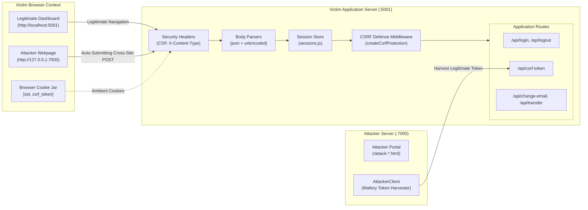

# CSRF Protection: Architecture and System Overview

This document provides a comprehensive technical breakdown of the CSRF Protection project, detailing its architectural design, threat model, API specifications, and defense mechanisms.

---

## 1. Project Purpose

The primary objective of this project is to provide a complete, transparent, and thoroughly tested reference implementation of Cross-Site Request Forgery (CSRF) defenses in Node.js/Express. It bridges the gap between academic theory and real-world application security by demonstrating how standard defenses fail when implemented naively, and how defense-in-depth principles reliably thwart attackers.

---

## 2. The CSRF Attack in 6 Lines

1. **Victim Authenticates**: Alice logs into her banking portal (`http://localhost:5001`), and the browser stores her session cookie (`sid`).
2. **Victim Visits Attacker**: Alice unknowingly visits Mallory's website (`http://127.0.0.1:7000`).
3. **Attacker Forges Request**: Mallory's page automatically submits a hidden HTML form pointing to `http://localhost:5001/api/transfer`.
4. **Browser Attaches Cookies**: Because browsers automatically attach stored cookies to cross-site requests, Alice's `sid` cookie is sent along.
5. **Vulnerable Server Executes**: The server sees Alice's valid session cookie and processes the transfer without verifying user intent.
6. **Damage Done**: Funds are transferred to Mallory without Alice's knowledge or consent.

---

## 3. Architecture Overview



---

## 4. File and Directory Structure

| Path | Purpose |
|---|---|
| `package.json` | Project configuration, pinned dependencies, Node engine requirements (`>=18`), and npm scripts. |
| `package-lock.json` | Exact pinned dependency lockfile. |
| `.env.example` | Environment variable template (contains no real secrets). |
| `.gitignore` | Prevents checking in `node_modules/`, `.env`, and test artifacts. |
| `README.md` | Front-page documentation, quick-start guide, and test matrix. |
| `playwright.config.js` | End-to-end browser test configuration (Chromium, serial execution). |
| `docs/PROJECT_OVERVIEW.md` | This document: full architecture, threat model, and API reference. |
| `docs/TEST_RUN_GUIDE.md` | Step-by-step instructions for automated and manual verification runs. |
| `docs/DEFENSES_AND_BYPASSES.md` | Deep dive into defense layers, cryptographic tokens, and bypass mechanisms. |
| `docs/screenshots/` | PNG screenshots generated during Playwright test execution. |
| `scripts/setup.js` | Generates a cryptographically strong 64-character hex `CSRF_SECRET` in `.env`. |
| `scripts/lab.js` | Starts victim and attacker servers simultaneously with customizable modes. |
| `src/config.js` | Centralized environment parser with strict startup validation. |
| `src/app.js` | Express app factory configuring security headers, body parsing, sessions, and routes. |
| `src/server.js` | Standalone server entry point binding to loopback (`127.0.0.1:5001`). |
| `src/csrf/index.js` | Production-grade reusable CSRF middleware factory (`createCsrfProtection`). |
| `src/csrf/token.js` | Session-bound token generation, HMAC calculation, parsing, and timing-safe comparison. |
| `src/csrf/originCheck.js` | Strict `Origin` and `Referer` allowlist validator. |
| `src/csrf/fetchMetadata.js` | Modern W3C Fetch Metadata (`Sec-Fetch-Site`) validator. |
| `src/lab/index.js` | Mode selector dispatching between active defenses and intentionally vulnerable variants. |
| `src/lab/off.js` | Intentionally vulnerable variant: zero CSRF protection. |
| `src/lab/weakToken.js` | Intentionally vulnerable variant: global token set without session binding (Demo 1). |
| `src/lab/weakReferer.js` | Intentionally vulnerable variant: naive Referer check skipped when missing (Demo 2). |
| `src/auth/users.js` | In-memory user database, `crypto.scrypt` password hashing, and input validation. |
| `src/auth/sessions.js` | In-memory session store with regeneration and cookie serialization. |
| `src/public/login.html` | Clean login UI with no inline scripts and strict CSP compliance. |
| `src/public/dashboard.html` | Clean banking dashboard UI with balance, email update, and transfer forms. |
| `src/public/app.js` | Frontend controller managing DOM events, CSRF tokens, and automated retries. |
| `src/public/styles.css` | Accessible and responsive application stylesheet. |
| `attacker/server.js` | Attacker Express application hosting exploit pages (`127.0.0.1:7000`). |
| `attacker/attackerClient.js` | HTTP client simulating attacker logging in to harvest valid CSRF tokens. |
| `attacker/pages/index.html` | Attacker portal cataloging all exploit vectors. |
| `attacker/pages/attack-change-email.html` | Auto-submitting cross-site email modification form. |
| `attacker/pages/attack-transfer.html` | Auto-submitting cross-site funds transfer form. |
| `attacker/pages/attack-no-referrer.html` | Auto-submitting form equipped with `<meta name="referrer" content="no-referrer">`. |
| `tests/unit/` | Jest unit test suite covering tokens, config, origin checks, and HTTP verbs. |
| `tests/integration/` | Supertest integration test suite covering end-to-end API flows and defense layers. |
| `tests/e2e/` | Playwright browser automation suite executing the 16-cell attack matrix. |

---

## 5. Lab Modes

| Mode | Behavior | Vulnerability Demonstrated |
|---|---|---|
| `off` | No CSRF checks are executed. Any cross-site mutation succeeds. | Demonstrates baseline vulnerability of standard web applications. |
| `weak-referer` | Blocks requests if `Referer` origin does not match allowed origins, but **allows requests if Referer is missing**. | Demonstrates bypass via `<meta name="referrer" content="no-referrer">`. |
| `weak-token` | Verifies that a token was issued by the server, but **does not verify which user or session it belongs to**. | Demonstrates token harvesting / unbound token bypass. |
| `secure` | Combines Fetch Metadata (`same-origin`), Origin allowlist, and session-bound signed double-submit cookies. | Comprehensive defense in depth. |

---

## 6. Route Specifications

### `GET /api/mode`
Returns active protection mode and session cookie SameSite policy.
- **Request**: `GET /api/mode HTTP/1.1`
- **Response**: `200 OK`
  ```json
  { "mode": "secure", "sameSite": "none" }
  ```

### `GET /api/csrf-token`
Issues a CSRF token for the active session (creates an anonymous session if not logged in).
- **Request**: `GET /api/csrf-token HTTP/1.1`
- **Response**: `200 OK`
  ```json
  { "token": "v1.4f2e9...6d8b.173108...c7a2" }
  ```

### `POST /api/login`
Authenticates user, regenerates session ID, and sets `sid` cookie.
- **Request**: `POST /api/login HTTP/1.1`
  ```json
  { "username": "alice", "password": "alice-password" }
  ```
- **Response**: `200 OK`
  ```json
  {
    "success": true,
    "message": "Logged in successfully",
    "user": { "username": "alice", "email": "alice@example.com", "balance": 1000 }
  }
  ```

### `POST /api/logout`
Destroys session and clears `sid` cookie.
- **Request**: `POST /api/logout HTTP/1.1`
- **Response**: `200 OK`
  ```json
  { "success": true, "message": "Logged out successfully" }
  ```

### `GET /api/me`
Retrieves authenticated user profile.
- **Request**: `GET /api/me HTTP/1.1`
- **Response (Authenticated)**: `200 OK`
  ```json
  { "username": "alice", "email": "alice@example.com", "balance": 1000 }
  ```
- **Response (Unauthenticated)**: `401 Unauthorized`
  ```json
  { "error": "Unauthorized" }
  ```

### `POST /api/change-email`
Updates current user's email address.
- **Request**: `POST /api/change-email HTTP/1.1`
  - Headers: `x-csrf-token: <token>`, `Origin: http://localhost:5001`, `Cookie: sid=...; csrf_token=...`
  ```json
  { "email": "alice-new@example.com" }
  ```
- **Response (JSON)**: `200 OK`
  ```json
  { "success": true, "message": "Email updated successfully", "email": "alice-new@example.com" }
  ```
- **Response (HTML Form Post)**: `200 OK`
  ```html
  <h1>Done</h1><p>Email changed to alice-new@example.com</p>
  ```

### `POST /api/transfer`
Transfers balance from current user to another existing user.
- **Request**: `POST /api/transfer HTTP/1.1`
  - Headers: `x-csrf-token: <token>`, `Origin: http://localhost:5001`, `Cookie: sid=...; csrf_token=...`
  ```json
  { "to": "mallory", "amount": 250 }
  ```
- **Response**: `200 OK`
  ```json
  { "success": true, "message": "Transferred 250 to mallory", "balance": 750 }
  ```

---

## 7. Configuration Reference

All settings can be configured via environment variables or `.env`:

| Variable | Default | Allowed Values | Description |
|---|---|---|---|
| `PROTECTION_MODE` | `secure` | `off`, `weak-token`, `weak-referer`, `secure` | Controls active CSRF defense implementation. |
| `CSRF_SECRET` | None | String (min 32 chars) | HMAC signing key. Required in `secure` mode. |
| `VICTIM_PORT` | `5001` | Integer (1–65535) | HTTP port for victim application. |
| `ATTACKER_PORT` | `7000` | Integer (1–65535) | HTTP port for attacker application. |
| `ALLOWED_ORIGINS` | `http://localhost:5001` | Comma-separated URLs | Trusted origins allowlist for Origin/Referer verification. |
| `SESSION_SAMESITE`| `none` | `none`, `lax`, `strict` | SameSite attribute for session cookies. Defaults to `none` for lab testing. |
| `TOKEN_TTL_MINUTES`| `60` | Positive number | Lifespan of CSRF tokens in minutes. |
| `ENABLE_TOKEN_CHECK`| `true` | `true`, `false` | Enables/disables token verification (for testing layers alone). |
| `ENABLE_ORIGIN_CHECK`| `true` | `true`, `false` | Enables/disables origin/metadata validation (for testing layers alone). |

---

## 8. Cryptographic Token Lifecycle

### Token Structure

$$\text{Format: } \texttt{v1.<random 16 bytes hex>.<expiresAtMs>.<hmacHex>}$$

$$\text{hmac} = \text{HMAC-SHA256}(\text{CSRF\_SECRET}, \text{sessionId} \parallel \text{"\|"} \parallel \text{random} \parallel \text{"\|"} \parallel \text{expiresAtMs})$$

```mermaid
sequenceDiagram
    autonumber
    actor Alice as Alice (Browser)
    participant Server as Victim Server (:5001)

    Note over Alice,Server: 1. Authentication & Token Issuance
    Alice->>Server: POST /api/login {username, password}
    Server->>Server: Validate credentials & regenerate session (new sid)
    Server-->>Alice: Set-Cookie: sid=new_session_id; HttpOnly
    Alice->>Server: GET /api/csrf-token (with sid cookie)
    Server->>Server: Generate token = v1.salt.expiry.HMAC(secret, sid|salt|expiry)
    Server-->>Alice: Set-Cookie: csrf_token=token; and JSON { token }

    Note over Alice,Server: 2. State-Changing Mutation
    Alice->>Server: POST /api/transfer {to, amount}
    Note over Alice,Server: Header: x-csrf-token = token<br/>Cookie: sid=..., csrf_token=token<br/>Sec-Fetch-Site: same-origin<br/>Origin: http://localhost:5001
    Server->>Server: 1. Method check (POST is unsafe)
    Server->>Server: 2. Fetch Metadata check (Sec-Fetch-Site == same-origin)
    Server->>Server: 3. Origin check (Origin in allowedOrigins)
    Server->>Server: 4. Double-submit check (header token == cookie token)
    Server->>Server: 5. Cryptographic check: HMAC matches current sid? Not expired?
    Server-->>Alice: 200 OK: Transfer completed
```

---

## 9. Threat Model

### What This Protects Against
1. **Cross-Site Form Submissions**: Attackers submitting form-urlencoded data from malicious origins.
2. **Cross-Site Fetch / XHR**: Unauthorized mutation requests dispatched from third-party websites.
3. **Login CSRF**: Forcing a victim to sign into an attacker-controlled account (prevented by protecting `/api/login` and regenerating sessions).
4. **Token Harvesting / Cookie Tossing**: Planting an attacker's valid token in a victim's request (prevented by binding tokens cryptographically to the victim's session ID).
5. **Referer Stripping**: Attackers using `<meta name="referrer" content="no-referrer">` (prevented by rejecting requests where both `Origin` and `Referer` are missing).
6. **Timing Attacks**: Exploiting character-by-character string comparisons (prevented by `crypto.timingSafeEqual`).

### What This Does NOT Protect Against (Out of Scope)
1. **Cross-Site Scripting (XSS)**: If an attacker executes arbitrary JavaScript within `http://localhost:5001`, they can read DOM tokens, issue authenticated requests, and defeat CSRF defenses.
2. **Subdomain Takeover**: If an attacker controls `attacker.localhost`, they may overwrite cookies via cookie tossing unless domain attributes are strictly isolated.
3. **Session Hijacking**: Physical theft of cookies or network sniffing on unencrypted plain HTTP.
4. **Clickjacking beyond Frame Restrictions**: Prevented here via CSP `frame-ancestors 'none'`, but complex UI redressing requires additional defense.
5. **Production Session Storage**: The in-memory session `Map` in `src/auth/sessions.js` is intended strictly for this demonstration lab, not horizontal scaling across clustered servers.

---

## 10. Technology Stack

- **Runtime**: Node.js `>=18` (tested on Node v24)
- **Framework**: Express v5 (`express@^5.3.0`)
- **Parsers & Config**: `cookie-parser@^1.4.7`, `dotenv@^16.6.1`
- **Testing & Assertions**: `jest@^29.7.0`, `supertest@^7.3.2`
- **Browser Automation**: Playwright (`@playwright/test@^1.65.0`, Chromium Headless Shell 158.0.8127.18)
- **Zero Third-Party CSRF Dependencies**: Handcrafted, fully auditable middleware using Node.js built-in `crypto` module.

---

## 11. Seed Accounts

| Username | Password | Email | Initial Balance | Role |
|---|---|---|---|---|
| `alice` | `alice-password` | `alice@example.com` | $1000 | Legitimate Victim |
| `mallory` | `mallory-password` | `mallory@example.com` | $0 | Attacker Account |
